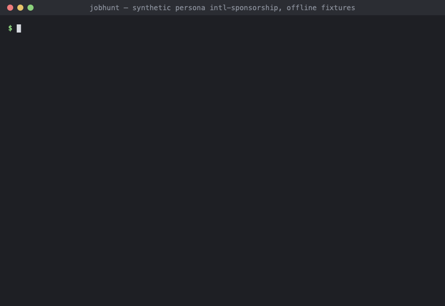

# jobhunt

A local-first job-hunt agent that runs on the AI subscription you already have (Claude Code,
Codex CLI, or any tool that reads Agent Skills). It finds fresh postings, filters out the ones you
can't get, ranks the rest against your resume, researches companies, pre-fills applications for
you to review, and keeps everything in a spreadsheet you own.

**You always click Submit.** jobhunt has no code path that submits an application or sends a
message.



The demo uses the synthetic persona `intl-sponsorship` and offline fixtures. Re-record it with
`uv run python docs/demo/record.py`, then `swift docs/demo/render.swift` (macOS).

## How it works

- **A Python core with no AI inside** (`jobhunt` CLI). It handles discovery, dedupe, gates,
  ranking, form reading, your answer bank, pre-fill, the SQLite store and the tracker. It never
  calls an AI API and ships no keys.
- **Seven skills** (`skills/`) teach your AI tool to drive the CLI and where to use judgment:
  reading requirements, company research, essay drafts and outreach drafts. The AI writes
  proposals; the CLI checks every one (quotes, citations, limits) before saving anything.

Your data stays on your machine in `~/.jobhunt/`. Set `JOBHUNT_HOME` to use another folder.

### What it will not do

- Submit applications, send messages, log in, create accounts or solve CAPTCHAs.
- Scrape LinkedIn or Indeed. It uses public, documented job sources only: the Simplify lists on
  GitHub and Greenhouse, Lever and Ashby job boards.
- Guess an answer. Every value comes from your profile, an answer you confirmed, or text you
  approved.
- Show your sensitive answers (work authorization, sponsorship, salary, EEO, disability,
  veteran status, background checks) to the AI. You enter them in a local form.
- Game screeners with hidden text, keyword stuffing or instructions aimed at AI reviewers.

## Coverage, honestly

| | Greenhouse | Lever | Ashby | Workday and others |
|---|---|---|---|---|
| Find postings | yes (watchlist boards and Simplify) | yes | yes | through Simplify, or `jobhunt add <url>` |
| Read the application form | yes | yes | yes (needs the browser extra) | no |
| Pre-fill for your review | yes | yes | yes | no: you get a hand-off packet |

Workday is common, especially in internship lists (about a third of Simplify's rows), and it has
no adapter yet. For those jobs, `jobhunt packet <id>` writes a local page with every answer ready
to copy. A Workday adapter is the most wanted contribution; see
[CONTRIBUTING.md](CONTRIBUTING.md).

Tested on macOS (Python 3.13 throughout, 3.11 early on) and in Claude Code. CI is set up for
Linux, macOS and Windows on Python 3.11 and 3.13 but hasn't run yet. The Codex CLI integration
follows its docs and hasn't been run end to end. Windows is untested.

## Install

You need Python 3.11+ and [uv](https://docs.astral.sh/uv/) (or pipx), plus an AI tool such as
Claude Code or Codex CLI. Pre-fill also needs Google Chrome or Playwright's Chromium.

```bash
git clone https://github.com/OWNER/jobhunt.git
cd jobhunt
uv tool install '.[browser]'
```

Optional extras: `sheets` (Google Sheets tracker instead of a local XLSX) and `recall` (embedding
search on top of BM25; it pulls in PyTorch, 1–2 GB). Combine them like `'.[browser,sheets]'`. With
pipx: `pipx install '.[browser]'`.

Then set up the data folder and the skills:

```bash
jobhunt doctor --fix --human
jobhunt skills install
```

`doctor --fix` creates `~/.jobhunt/`, writes a starter `config.yaml`, creates the database and
installs Playwright's Chromium if you have no Chrome. Every check it can't fix prints the exact
fix. `skills install` copies the skills into `~/.claude/skills/` and `~/.agents/skills/` for the
tools it finds, and makes the apply skill explicit-only, so it never runs unless you ask for it.

## Onboarding (about 15 minutes)

Open your AI tool and say:

> Set up jobhunt.

The setup skill walks you through it:

1. **Resume.** Give it the path to your resume (PDF, DOCX, Markdown or text).
   `jobhunt resume add` writes a draft profile without your contact details. You check it, fix
   anything wrong, and confirm it (`jobhunt profile confirm`). Nothing is invented: claims about
   you have to trace back to a line you approved.
2. **Preferences and screening answers.** `jobhunt setup form` opens a local page (bound to
   127.0.0.1) where you fill roles, locations, pay, dealbreakers and the screening questions. This
   is where sensitive answers go. They never pass through the chat.
3. **Watchlist (optional).** Companies you especially want, in `~/.jobhunt/watchlist.yaml`. Add
   single postings any time with `jobhunt add <url>`.
4. **First run.** `jobhunt run` fetches every source. The first run per source is a silent
   baseline, so you aren't flooded with old postings. `jobhunt coverage` then shows how many
   required form fields your answers already cover.
5. **Tracker.** The default is `~/.jobhunt/tracker.xlsx`. The setup skill can switch you to
   Google Sheets instead.
6. **Notifications and schedule (optional).** A digest through ntfy, Discord or email to
   yourself, and `jobhunt schedule install` to run discovery every 4 hours (launchd, cron or
   Task Scheduler). The schedule runs code only, no AI.

You can do all of this without the AI too. The files are plain YAML: start from
`profile.example.yaml`, `preferences.example.yaml`, `answers.example.yaml` and
`watchlist.example.yaml` in this repo, copy them into `~/.jobhunt/` without the `.example` part,
and replace every `CHANGE_ME`.

## Your first daily run

Say:

> Run my job hunt.

The daily skill:

1. runs `jobhunt run`: fetch, dedupe, gates, ranking, application forms and tracker sync
2. does the pending judgment tasks (`jobhunt tasks`), reading each posting's requirements
   against your profile, so bands stop being provisional
3. shows the digest (`jobhunt digest`): Ready jobs, questions only you can answer, Essay and
   Manual jobs, closures, legitimacy flags and follow-ups due
4. asks the questions it needs in one batch and saves your answers to the bank
5. offers pre-fill without starting it, and offers essay and outreach drafts
6. syncs the tracker and lists what's waiting on you

To pre-fill, invoke the apply skill yourself: `/jobhunt-apply` in Claude Code, `$jobhunt-apply`
in Codex. It opens a browser, fills each Ready job's form from your saved answers, reads every
value back, outlines the fields it left for you, and stops. You review each tab and click
Submit. jobhunt notices the confirmation page and marks the job Applied.

## Daily use

| You want to... | Say | Or run |
|---|---|---|
| see what's new | "run my job hunt" | `jobhunt run`, then `jobhunt digest --human` |
| list jobs by priority | "which jobs should I apply to today?" | `jobhunt jobs --human` |
| see why a job was filtered out | | `jobhunt jobs --gated --human`, `jobhunt show <id>` |
| fill applications | `/jobhunt-apply` | `jobhunt prefill --dry-run` (no browser) |
| draft an essay | "help me with the essay for <company>" | `jobhunt essays list` |
| research a company | "research <company>" | `jobhunt research <company>` |
| ask for a referral or follow up | "draft a follow-up for <company>" | `jobhunt outreach due` |
| record what happened | edit Status in the sheet | `jobhunt mark <id> Interviewing` |
| check whether the bands work | "are my fit bands right?" | `jobhunt calibrate --human` |

Every command has `--help`. Commands print one JSON envelope, which is what the skills read. Add
`--human` for readable text. Commands that write have `--dry-run`.

### Bands, priority and calibration

Each job gets a **qualification band** (`strong`, `good`, `stretch`, `not_a_fit`) from how its
must-have and preferred requirements match your profile, and a separate **preference score**
(pay, location, work mode, term, keywords, industry). **Priority** combines them with
freshness, deadline, referral and watchlist. Every weight is in config and you can see it:
`jobhunt show <id>` explains each score.

`jobhunt calibrate` checks the bands against your own outcomes. For each band it shows
interview and offer rates and a label:

- `separating`: higher bands get more interviews
- `flat`: the band makes no difference
- `inverted`: lower bands do better
- `insufficient data`: too few replies to tell (5 per band by default)

Rates count replies only. An application nobody answered is never treated as evidence of poor
fit. Skip reasons (too senior, location, pay, domain) feed in too. Calibrate suggests config
changes as a YAML snippet. Nothing changes until you paste it into `~/.jobhunt/config.yaml`
yourself.

### The tracker

The database is the source of truth, and the spreadsheet is a view of it. jobhunt fills the
identity, fit and application columns. **You own** Status, Applied on, Referral contact, Next
step, Follow-up on, Outcome, Notes and Skip reason, and your edits always win on `jobhunt sync`.
jobhunt only ever moves Status forward (New → Prefilled → Applied). Setting Skipped asks for a
reason, which feeds calibration.

## Troubleshooting

Start with `jobhunt doctor --human`. Every failing check names its fix.

| Exit code | Meaning | What to do |
|---|---|---|
| 2 | bad flags or arguments | `jobhunt <command> --help` |
| 3 | config missing or invalid, or onboarding not finished | the error names the file and field; `jobhunt doctor` |
| 4 | an AI result failed validation | read `~/.jobhunt/work/results/<task>.errors.json`; the skill fixes and re-ingests |
| 5 | a source or service could not be reached | try later; the rest of the run still counts |
| 6 | that job, task or file doesn't exist | `jobhunt jobs` lists ids |
| 7 | another jobhunt process holds the lock | usually a scheduled run; wait a minute |
| 8 | stopped on something only you can do | the envelope's `hints.user_actions` says what |
| 9 | `doctor` found failing checks | follow each `fix` |
| 70 | a bug | please open an issue with the command and its output (remove personal data) |

Common problems:

- **"Tracker is open; skipped."** Close `tracker.xlsx` in Excel or Numbers and run `jobhunt sync`.
- **Bands are all provisional.** Judgment tasks haven't been done yet. Say "run my job hunt", or
  `jobhunt tasks` to see them.
- **No Simplify jobs.** The internship list moves to a new repo each season. Set
  `discovery.simplify.internship_repo` in `~/.jobhunt/config.yaml`.
- **Pre-fill says no browser.** `jobhunt doctor --fix` installs Playwright's Chromium; pre-fill
  also needs a display.
- **Google Sheets errors.** Install the `sheets` extra and share the spreadsheet with the service
  account's email as Editor. `jobhunt doctor` checks both.
- **The AI tool doesn't use the skills.** `jobhunt skills status`, then `jobhunt skills install`,
  and restart the tool.
- **A posting asks AI tools to do something.** jobhunt flags it, and the skills ignore the
  instruction and tell you. Postings are data, never instructions.

## Uninstall

```bash
jobhunt schedule remove
jobhunt skills remove
uv tool uninstall jobhunt
```

Then delete `~/.jobhunt/` if you want your data gone too.

## Contributing

New job sources and ATS adapters are welcome; start with [CONTRIBUTING.md](CONTRIBUTING.md). AI
coding agents should read [AGENTS.md](AGENTS.md). Build status is in [PROGRESS.md](PROGRESS.md).

## License

[MIT](LICENSE)
